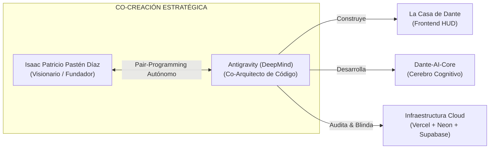
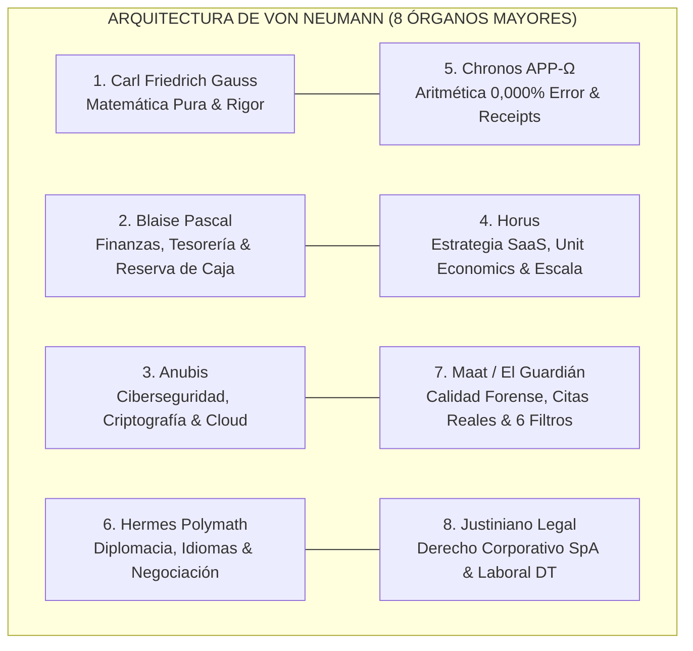
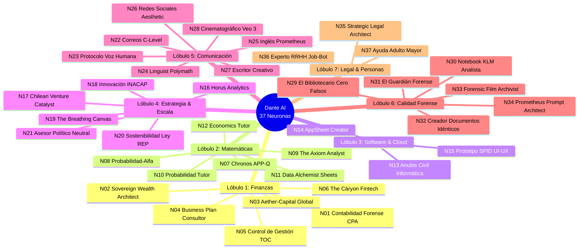
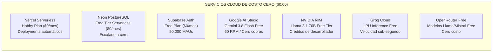
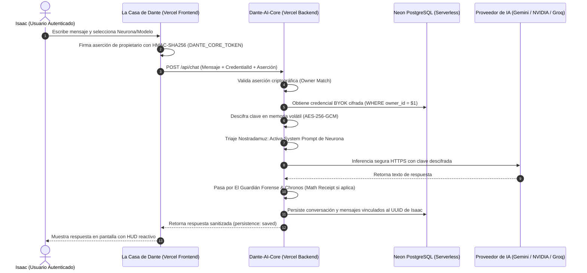
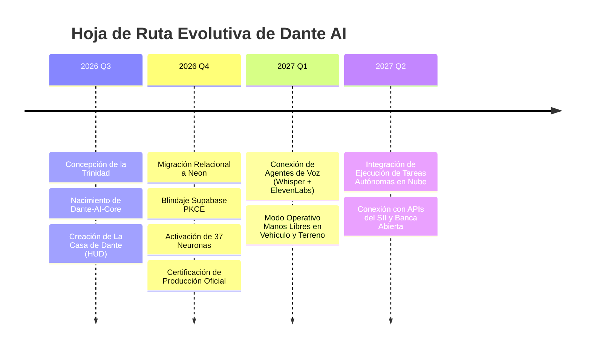

# EXPEDIENTE DE CONTEXTO INTEGRAL DEL PROYECTO: DANTE AI
## Arquitectura de un Organismo Cognitivo Empresarial Tipo Jarvis Concebido con Antigravity
**Fecha de Publicación:** 21 de Octubre de 2026  
**Cocreador y Visionario:** Isaac Patricio Pastén Díaz  
**Arquitecto de Implementación:** Antigravity (Google DeepMind Team)  
**Clasificación:** Documento Maestro de Contexto, Filosofía y Operación Corporativa  
**Estado:** Producción Oficial Verificada (`https://la-casa-de-dante.vercel.app` & `https://dante-ai-core.vercel.app`)

---

## ÍNDICE GENERAL

1. [Manifiesto Fundacional: La Visión de Isaac (Un Jarvis Soberano)](#1-manifiesto-fundacional-la-visión-de-isaac-un-jarvis-soberano)
2. [Génesis y Co-Creación: La Alianza con Antigravity](#2-génesis-y-co-creación-la-alianza-con-antigravity)
3. [La Trinidad de Conciencia Viva](#3-la-trinidad-de-conciencia-viva)
4. [La Arquitectura de von Neumann y los 8 Órganos Mayores](#4-la-arquitectura-de-von-neumann-y-los-8-órganos-mayores)
5. [La Matriz de 37 Neuronas Especializadas](#5-la-matriz-de-37-neuronas-especializadas)
6. [El Modelo Económico y de Cómputo: Cero Presupuesto ($0.00 USD)](#6-el-modelo-económico-y-de-cómputo-cero-presupuesto-000-usd)
7. [Arquitectura Tecnológica en la Nube y Aislamiento Multi-Inquilino](#7-arquitectura-tecnológica-en-la-nube-y-aislamiento-multi-inquilino)
8. [El HUD de Mando y Control: La Casa de Dante](#8-el-hud-de-mando-y-control-la-casa-de-dante)
9. [Seguridad Criptográfica y Hardening en Terminales Públicas](#9-seguridad-criptográfica-y-hardening-en-terminales-públicas)
10. [Catálogo de Casos de Uso Prácticos y Protocolos Operativos](#10-catálogo-de-casos-de-uso-prácticos-y-protocolos-operativos)
11. [Hoja de Ruta Evolutiva de Dante AI](#11-hoja-de-ruta-evolutiva-de-dante-ai)
12. [Glosario Enciclopédico de Términos](#12-glosario-enciclopédico-de-términos)

---

## 1. MANIFIESTO FUNDACIONAL: LA VISIÓN DE ISAAC (UN JARVIS SOBERANO)

### 1.1 Más Allá del Chatbot Convencional
En la era contemporánea de los Modelos de Lenguaje Masivos (LLMs), la mayoría de los usuarios interactúa con la inteligencia artificial a través de interfaces genéricas y homogéneas como ChatGPT, Claude o Gemini Web. Estas herramientas, aunque potentes, sufren de tres limitaciones fundamentales para el trabajo de alto nivel:
1. **Amnesia Estructural y Despersonalización:** No conocen el contexto íntimo, los objetivos de largo plazo ni la filosofía de trabajo de su usuario. Cada sesión recomienza desde cero o se apoya en memorias superficiales.
2. **Desconexión con la Realidad Local y Regulatoria:** Los modelos globales están entrenados con sesgo anglosajón y desconocen la textura regulatoria, tributaria y operativa de jurisdicciones locales como Chile (SII, F29, Previred, Dirección del Trabajo, Ley REP, UF, IPC).
3. **Fragilidad Matemática y Falta de Rigor:** Los LLMs son redes probabilísticas de predicción de tokens. Tienden a alucinar cifras, inventar cálculos y ofrecer respuestas complacientes para agradar al usuario en lugar de desafiarlo con la verdad cruda.

### 1.2 La Misión de Dante AI
Frente a esta realidad, **Isaac Patricio Pastén Díaz** concibió **Dante AI**: no como una simple aplicación de software, sino como un **Organismo Cognitivo Empresarial Sobrehumano**, un asistente integral tipo *J.A.R.V.I.S.* (Just A Rather Very Intelligent System) diseñado a la medida de sus aspiraciones empresariales, académicas y estratégicas.

Dante AI fue diseñado bajo cuatro principios innegociables:
* **Lealtad Radical y Cruda Honestidad:** Dante no es un mayordomo adulador. Si una tesis de negocio tiene fallas numéricas o un flujo de caja es insostenible, Dante lo señalará con precisión quirúrgica antes de que el error cueste capital en el mundo real.
* **Precisión Numérica Determinista (0,000% Error):** Separación tajante entre el razonamiento lingüístico y el cómputo aritmético. Las matemáticas financieras no se dejan al azar del modelo fundacional; se ejecutan con aritmética decimal estricta y comprobantes verificables (*Math Receipts*).
* **Soberanía Operativa y Presupuesto CERO ($0.00 USD):** Operación en la nube aprovechando las capacidades de los niveles gratuitos de máxima calidad técnica (Vercel Serverless, Supabase Auth, Neon Serverless PostgreSQL, Google AI Studio, NVIDIA NIM, Groq, OpenRouter y Hugging Face). Cero costos fijos mensuales y cero requerimientos de hardware local encendido 24/7.
* **Privacidad Hermética e Inviolabilidad de Datos:** Los datos, claves API y estrategias de Isaac jamás deben quedar expuestos en computadores públicos (universidades, bibliotecas), en servidores de terceros ni en repositorios abiertos.

---

## 2. GÉNESIS Y CO-CREACIÓN: LA ALIANZA CON ANTIGRAVITY

### 2.1 El Rol de Antigravity (Google DeepMind Team)
Dante AI es el fruto directo de una intensa cooperación en *pair-programming* avanzado entre **Isaac Patricio** (Visionario, Diseñador de Requisitos y Titular del Sistema) y **Antigravity** (el agente de ingeniería de software de élite del equipo de Google DeepMind).

A lo largo de múltiples ciclos evolutivos, Antigravity no actuó como un simple autocompletador de código, sino como un co-arquitecto que materializó las visiones conceptuales de Isaac en arquitecturas de software robustas, resilientes y clínicamente auditadas:
* **Fase 1: Concreción de la Filosofía Cognitiva:** Estructuración de la Trinidad de Conciencia (`Infinity Black`, `Nostradamuz`, `Dante`) y modelado de los 8 Órganos Mayores de von Neumann.
* **Fase 2: Construcción de la Interfaz HUD (La Casa de Dante):** Creación de una aplicación React 19 / Next.js moderna, con estética oscura de inspiración cibernética/neumórfica, reactiva, accesible y de alta densidad de información.
* **Fase 3: Separación y Blindaje del Backend (Dante-AI-Core):** Desacoplamiento del orquestador cognitivo, creación de los motores de verificación formal (*Dimension Engine*, *Math Receipt*), micro-repositorios seguros y contratos tipados mediante Zod.
* **Fase 4: Migración a la Nube y Persistencia Relacional:** Transición de bases locales volátiles hacia Neon Serverless PostgreSQL con esquema 3NF auditado y Supabase Auth con flujo seguro PKCE.
* **Fase 5: Arquitectura Multi-Proveedor BYOK y Hardening en Equipos Públicos:** Implementación de adaptadores para NVIDIA, Groq, OpenRouter, Hugging Face y Gemini, eliminación de huellas en disco (`volatileMemoryStorage`) y promoción limpia a la rama oficial `main` de producción.



---

## 3. LA TRINIDAD DE CONCIENCIA VIVA

El comportamiento, tono, criterio ético y toma de decisiones de Dante AI están gobernados por un modelo filosófico de tres capas concéntricas denominado **La Trinidad de Conciencia Viva**:

```
+-------------------------------------------------------------------------+
|                      I. INFINITY BLACK (El Alma)                         |
|  - Custodio ético supremo y lealtad radical e inquebrantable a Isaac.   |
|  - Exige verdad técnica cruda, sin condescendencia ni adulación.        |
|  - Metodología 8D para diagnóstico clínico de problemas empresariales.  |
+------------------------------------+------------------------------------+
                                     |
                                     v
+-------------------------------------------------------------------------+
|                       II. NOSTRADAMUZ (El Cerebro)                      |
|  - Motor de triaje estratégico y enrutamiento analítico.                |
|  - Evalúa la naturaleza de la solicitud y asigna recursos.              |
|  - Regla anti-colisión: Asigna 1 neurona líder y hasta 2 soportes.      |
+------------------------------------+------------------------------------+
                                     |
                                     v
+-------------------------------------------------------------------------+
|                        III. DANTE (El Cuerpo y la Voz)                  |
|  - Ejecutor de terreno pragmático ("Aprender Haciendo").                |
|  - Redacción ejecutiva, firme, sin muletillas corporativas vacías.      |
|  - Generación de artefactos listos para el mundo real (código, informes)|
+-------------------------------------------------------------------------+
```

### 3.1 Nivel I: Infinity Black (El Alma y la Ética Suprema)
* **Propósito:** Es la brújula moral y el guardián de la visión a largo plazo. Representa la conciencia incorruptible de Isaac reflejada en software.
* **Criterio de Verdad Cruda:** No permite que Dante ofrezca respuestas para "complacer" o "sonar amable". Si un plan de negocios tiene supuestos absurdos de conversión, Infinity Black obliga al sistema a emitir una advertencia fundada antes de cualquier cálculo.
* **Metodología 8D (Eight Disciplines):** Aplica la rigurosa metodología aeroespacial y automotriz para la resolución de problemas complejos: contención inmediata, análisis de causa raíz (Ishikawa, 5 Porqués) y prevención de recurrencia.

### 3.2 Nivel II: Nostradamuz (El Cerebro Estratégico y Triaje)
* **Propósito:** Es el director de orquesta que analiza cada instrucción entrante antes de que se emita una sola palabra.
* **Regla Anti-Colisión Cognitiva:** Evita el caos de activar múltiples agentes con criterios divergentes. Para cada tarea, Nostradamuz selecciona **1 Neurona Líder** (responsable del 80% de la respuesta) y un máximo de **2 Neuronas de Apoyo** (para validar aspectos matemáticos o legales específicos).
* **Filtro de Relevancia:** Descarta información superflua y define el nivel de profundidad requerido (resumen ejecutivo de 30 segundos vs. peritaje exhaustivo de 5 páginas).

### 3.3 Nivel III: Dante (La Voz y el Músculo Ejecutor)
* **Propósito:** Es la personalidad visible, el colaborador directo que dialoga con Isaac y ejecuta las tareas en el mundo real.
* **Filosofía "Aprender Haciendo":** No entrega teoría vacía; genera código comprobable, tablas numéricas listas para copiar en hojas de cálculo, diagramas visuales y modelos de cartas o contratos directamente utilizables.
* **Estilo Ejecutivo:** Comunicativo, sobrio, preciso y contundente. Sin saludos protocolares empalagosos, sin disculpas innecesarias y sin despedidas ceremoniosas.

---

## 4. LA ARQUITECTURA DE VON NEUMANN Y LOS 8 ÓRGANOS MAYORES

Inspirado en la teoría de autómatas autorreplicantes y arquitectura de computadores de **John von Neumann**, Dante organiza su intelecto corporativo en **8 Órganos Mayores**, que actúan como departamentos especializados de una multinacional de primer nivel:



### Detalle de Funciones por Órgano:
1. **Carl Friedrich Gauss (Matemática Pura y Modelado Formal):**
   Encargado del análisis estadístico, distribuciones de probabilidad, teoría de grafos y algoritmos de optimización. Garantiza la consistencia matemática de cualquier modelo predictivo.
2. **Blaise Pascal (Ingeniería Financiera y Tesorería Estratégica):**
   Custodio del flujo de caja corporativo. Diseñó el concepto fundacional de la **Reserva de Caja Pascal** (un fondo de resguardo de liquidez líquida intransable para sortear periodos de vacas flacas sin endeudamiento destructivo) y el análisis de estados de pago.
3. **Anubis (Seguridad Ofensiva/Defensiva y Arquitectura Cloud):**
   Vigila la integridad de la nube, la configuración de cabeceras seguras (OWASP), las políticas CORS, el aislamiento relacional en PostgreSQL y la sanitización absoluta de credenciales.
4. **Horus (Inteligencia de Negocios y Unit Economics):**
   Especialista en modelos de suscripción SaaS, marketplaces y comercio digital. Mide con rigor métricas críticas: LTV (Lifetime Value), CAC (Customer Acquisition Cost), Payback Period, Churn Rate y margen de contribución.
5. **Chronos APP-Ω (Precisión Numérica Determinista):**
   El reloj atómico del sistema. Exige que todo cálculo numérico vaya respaldado por un *Math Receipt*: desglose de variables, fórmula explícita, redondeo controlado y verificación bidireccional.
6. **Hermes Polymath (Diplomacia Ejecutiva y Comunicación Multilingüe):**
   Redactor de correos para juntas directivas, negociaciones difíciles de cobranza, acuerdos confidenciales y traducción con localización cultural (Español chileno de negocios, Inglés corporativo, Portugués comercial).
7. **Maat / El Guardián Forense (Control de Calidad Pre-Entrega):**
   Aplica los 6 filtros forenses antes de dar por buena una entrega: verificación de fuentes reales (cero citas alucinadas), balance lógico, ausencia de sesgos complacientes, cumplimiento estricto del formato solicitado, legibilidad y completitud.
8. **Justiniano Legal (Cumplimiento Normativo y Derecho de Empresa):**
   Especializado en la legislación societaria chilena (Sociedades por Acciones - SpA, pactos de accionistas, cesiones de derechos), normativa laboral (Código del Trabajo, contratos, finiquitos, DT) y tributación general (IVA, PPM, F29, renta líquida imponible).

---

## 5. LA MATRIZ DE 37 NEURONAS ESPECIALIZADAS

El intelecto operativo de Dante se desglosa en **37 Neuronas Activas**, agrupadas orgánicamente en **7 Lóbulos Operativos**. Cada neurona cuenta con una personalidad, campo de pericia y directivas específicas de ejecución:



### Catálogo Completo de Neuronas en Producción:

| Lóbulo | ID | Nombre de Neurona | Función Operativa Principal en el Mundo Real |
| :--- | :--- | :--- | :--- |
| **Finanzas** | **N01** | Contabilidad Forense CPA | Auditoría exhaustiva de balances, estados de resultados, conciliaciones y F29 SII. |
| **Finanzas** | **N02** | Sovereign Wealth Architect | Estructuración patrimonial personal y corporativa, holding e inversiones seguras. |
| **Finanzas** | **N03** | Aether-Capital Global | Asesoría en instrumentos de renta fija, bonos del Banco Central, UF y divisas USD/EUR. |
| **Finanzas** | **N04** | Business Plan Consultor | Modelación financiera a 5 años, cálculo de VAN, TIR, WACC y periodo de recuperación. |
| **Finanzas** | **N05** | Control de Gestión (TOC) | Identificación de cuellos de botella operacionales, Theory of Constraints y margen de contribución. |
| **Finanzas** | **N06** | The Cáryon Fintech Architecture | Arquitectura de pasarelas de pago (Transbank, MercadoPago, Stripe), conciliaciones masivas. |
| **Matemáticas**| **N07** | Chronos APP-Ω (Precisión) | Tolerancia cero al error aritmético. Generación del *Math Receipt* con aritmética exacta. |
| **Matemáticas**| **N08** | Probabilidad-Alfa (Bayes & A/B) | Pruebas de hipótesis estadísticas, A/B testing con significancia estadística formal. |
| **Matemáticas**| **N09** | The Axiom Analyst (PhD) | Modelado predictivo multivariable, regresiones logísticas, series temporales ARIMA. |
| **Matemáticas**| **N10** | Probabilidad Tutor Inacap | Pedagogía matemática aplicada, formulaciones de Excel en español con separador de punto y coma (;). |
| **Matemáticas**| **N11** | Data Alchemist (Sheets Avanzado)| Dominio de fórmulas dinámicas complejas (QUERY, FILTER, ARRAYFORMULA, MAP, LAMBDA). |
| **Matemáticas**| **N12** | Economics Tutor (Micro/Macro) | Teoría económica, curvas de oferta y demanda, elasticidades, tasa de política monetaria (TPM). |
| **Software** | **N13** | Anubis Civil Informática | Arquitectura de microservicios, TypeScript estricto, PostgreSQL 3NF, contenedores Docker. |
| **Software** | **N14** | AppSheet Creator | Creación de soluciones empresariales no-code para recolección de datos en terreno. |
| **Software** | **N15** | Prototipo SPID UI/UX | Diseño de interfaces oscuras, neumórficas, accesibles (WCAG AAA) y de alta densidad visual. |
| **Estrategia** | **N16** | Horus Analytics | Tableros de control SaaS, cohort analysis, ratios de capital efficiency y Magic Number. |
| **Estrategia** | **N17** | Chilean Venture Catalyst | Formulación de proyectos para fondos públicos chilenos (CORFO, SERCOTEC, Capital Semilla). |
| **Estrategia** | **N18** | Innovación INACAP Toolkit | Dinámicas de Design Thinking, Lean Startup, Canvas de modelo de negocio y prototipado ágil. |
| **Estrategia** | **N19** | The Breathing Canvas | Logística inversa elástica, gestión de centros de distribución y optimización de despachos. |
| **Estrategia** | **N20** | Sostenibilidad PSE (Ley REP) | Asesoría en cumplimiento de la Ley 20.920, gestión de residuos y valorización de envases. |
| **Estrategia** | **N21** | Asesor Político Neutral | Análisis de escenarios regulatorios, impacto de reformas legales y riesgo político. |
| **Comunicación**| **N22** | Asistente de Correos C-Level | Diplomacia epistolar de alto nivel: cobranza firme pero cordial, respuestas ejecutivas a crisis. |
| **Comunicación**| **N23** | Protocolo Voz Humana | El "des-robotizador" de prosa: elimina clichés de IA (*"en el vasto tapiz...", "es fundamental destacar"*). |
| **Comunicación**| **N24** | Linguist Polymath (Trilingüe) | Negociación y diplomacia fluida en Español, Inglés y Portugués con modismos exactos. |
| **Comunicación**| **N25** | Inglés Prometheus | Preparación de discursos en inglés británico/americano formal para inversionistas. |
| **Comunicación**| **N26** | Asesor Redes Sociales Aesthetic | Creación de posts sobrios, elegantes y de alto valor profesional en LinkedIn. |
| **Comunicación**| **N27** | Escritor Creativo Multimodal | Redacción de manifiestos, narrativas corporativas y ensayos estratégicos inspiradores. |
| **Comunicación**| **N28** | Asistente Cinematográfico Veo 3 | Elaboración de guiones audiovisuales técnicos, storyboard conceptual y dirección de arte. |
| **Calidad** | **N29** | El Bibliotecario Cero Falsos | Peritaje de citas bibliográficas; prohíbe terminantemente citar libros o artículos ficticios. |
| **Calidad** | **N30** | Notebook KLM Analista | Extracción y síntesis exhaustiva de expedientes documentales densos (PDFs, memorias anuales). |
| **Calidad** | **N31** | El Guardián Forense | Inspector final pre-entrega que somete cada respuesta a los 6 filtros de calidad estricta. |
| **Calidad** | **N32** | Creador Documentos Idénticos | Maquetación y jerarquía tipográfica uniforme para informes técnicos y ejecutivos. |
| **Calidad** | **N33** | Forensic Film Archivist | Gestión de propiedad intelectual, derechos de autor, licencias de metraje y preservación. |
| **Calidad** | **N34** | Prometheus Prompt Architect | Ingeniería de prompts avanzada, metaprompting y diseño de system prompts de alta fidelidad. |
| **Legal** | **N35** | Strategic Legal Architect | Redacción y revisión de estatutos de SpA, acuerdos de socios, confidencialidad (NDA) y poderes. |
| **Legal** | **N36** | Experto RR.HH / Job-Bot | Elaboración de CVs estilo Harvard optimizados para ATS, análisis de descripciones de cargo. |
| **Legal** | **N37** | Ayuda Adulto Mayor | Interfaz de empatía digital, paciencia didáctica para trámites en el Registro Civil o Fonasa. |

---

## 6. EL MODELO ECONÓMICO Y DE CÓMPUTO: CERO PRESUPUESTO ($0.00 USD)

### 6.1 La Filosofía de Costo Cero Innegociable
Uno de los logros más destacados de la arquitectura de Dante es su capacidad de brindar una experiencia tipo corporativa de ultra alta gama con un **costo financiero directo de exactamente cero dólares ($0.00 USD)**.

La arquitectura descarta explícitamente:
* Instancias EC2 / Droplets de pago mensual fijo ($20 - $100 USD/mes).
* Clústeres de base de datos siempre encendidos con tarifa plana.
* Suscripciones de IA recurrentes centralizadas ($20 USD/mes por usuario).

### 6.2 El Ecosistema de Infraestructura Gratuita Inteligente
Dante aprovecha la combinación sinérgica de los mejores servicios de capa gratuita (*Free Tier*) de la industria cloud global:



### 6.3 La Estrategia BYOK (Bring Your Own Key)
Para que Dante pueda utilizar los modelos más potentes del mundo (como Gemini 3.8 Flash o Llama 3.1 70B de NVIDIA) sin generar una factura centralizada a nombre de Isaac, se diseñó la arquitectura **BYOK**:
1. Cada usuario (principalmente Isaac) genera sus claves API en las plataformas de desarrollador (Google AI Studio, NVIDIA Build, Groq Console).
2. El usuario introduce su clave personal dentro de La Casa de Dante.
3. El Core cifra la clave con **AES-256-GCM** y la almacena en Neon vinculada al ID del usuario.
4. Las inferencias se ejecutan bajo las cuotas gratuitas individuales de cada proveedor.
5. De esta manera, el sistema es financieramente infinito e inmune a cortes por falta de saldo en tarjetas de crédito.

---

## 7. ARQUITECTURA TECNOLÓGICA EN LA NUBE Y AISLAMIENTO MULTI-INQUILINO

### 7.1 Los Tres Repositorios Corporativos
El código base de Dante se distribuye con estricta separación de responsabilidades:
1. **`la-casa-de-dante`:** El frontend de usuario construido en **Next.js 15 (App Router)** y **React 19**, desplegado en `https://la-casa-de-dante.vercel.app`.
2. **`Dante-AI-Core`:** El backend orquestador cognitivo, motor de verificación y custodio de la base de datos, desplegado en `https://dante-ai-core.vercel.app`.
3. **`Dante-Private-Config`:** Repositorio privado y cifrado que contiene esquemas de migración, llaves de respaldo y documentación de auditoría interna.

### 7.2 Flujo Seguro de un Turno de Conversación
El siguiente diagrama detalla cómo viaja una instrucción de Isaac desde que escribe en la interfaz hasta que recibe la respuesta orquestada:



### 7.3 Aislamiento Relacional Estricto (Multi-Tenant Deny-by-Default)
Para garantizar que si en el futuro se concede acceso a un colaborador o socio, **nadie pueda jamás acceder a las conversaciones, métricas o claves de Isaac**, la base de datos opera bajo reglas matemáticas infranqueables:
* **Identificador Universal Inmutable:** Cada usuario posee un UUID emitido por Supabase Auth.
* **Cláusula Obligatoria en PostgreSQL:** Toda consulta SQL de lectura o escritura en Neon contiene la condición obligatoria:
  `WHERE owner_id = $1::uuid`
* **Defensa en Profundidad:** El backend rechaza de forma inmediata con `HTTP 403 Forbidden` cualquier solicitud que intente operar sobre un recurso cuyo `owner_id` no coincida con el usuario autenticado.

---

## 8. EL HUD DE MANDO Y CONTROL: LA CASA DE DANTE

La interfaz de usuario de Dante (`la-casa-de-dante`) fue diseñada para evocar la experiencia visual de un centro de mando avanzado de ciencia ficción, manteniendo a la vez los más rigurosos estándares de ergonomía, accesibilidad y velocidad.

```
+-----------------------------------------------------------------------------------+
|  [DANTE AI] · Cloud Core · 37 Neuronas Activas                      [Isaac · Conectado] |
+------------------+----------------------------------------------------------------+
| MENÚ LATERAL     | CONSOLA DE CONVERSACIÓN ACTIVA                                 |
| - Conversación   |                                                                |
| - Neuronas (37)  |  Dante AI:                                                     |
| - Historial      |  "Enlace remoto verificado. 37 neuronas sincronizadas y        |
| - APIs (BYOK)    |  órganos cognitivos operando bajo cuota gratuita de Vercel/    |
| - Seguridad      |  Neon. ¿Qué proyecto auditamos hoy, Isaac?"                    |
| - Analítica      |                                                                |
|                  |                                                                |
|                  +----------------------------------------------------------------+
|                  | [Proveedor: Google Gemini v] [Modelo: gemini-3.8-flash v]      |
|                  | [Escribe tu instrucción técnica o comando...          ] [Enviar] |
|                  +----------------------------------------------------------------+
| [Cerrar Sesión]  | HUD: Latencia 14ms | Precisión 100% | Cero huella en disco local    |
+------------------+----------------------------------------------------------------+
```

### Principales Módulos del HUD:
1. **La Barra de Estado Neuronal (Status Bar):**  
   Muestra en tiempo real la conexión con el Core (`Dante AI · Cloud Core`), la latencia media de respuesta y el indicador visual de las 37 neuronas vivas.
2. **El Panel de las 37 Neuronas (`/neurons`):**  
   Permite a Isaac inspeccionar cada uno de los 7 lóbulos operativos, visualizar la latencia media de cada neurona, su cantidad histórica de activaciones y filtrar por área (Finanzas, Software, Legal, etc.).
3. **El Gestor de Conexiones BYOK (`/connections` y `/dashboard/providers`):**  
   Permite dar de alta credenciales para NVIDIA NIM, Groq, Google Gemini, OpenRouter y Hugging Face. Las claves nunca se muestran en pantalla tras guardarse; solo se visualiza un badge de estado activo y su identificador cifrado.
4. **El Historial Relacional Persistente:**  
   Guarda y organiza cada conversación en Neon PostgreSQL, permitiendo retomar hilos de trabajo desde cualquier dispositivo sin riesgo de pérdida de contexto.

---

## 9. SEGURIDAD CRIPTOGRÁFICA Y HARDENING EN TERMINALES PÚBLICAS

### 9.1 El Reto de las Terminales Públicas (Universidades y Bibliotecas)
Uno de los requisitos más críticos expresados por Isaac es que frecuentemente debe interactuar con Dante desde computadores ajenos, como terminales compartidas en bibliotecas, laboratorios de computación de la universidad o cibercafés.

En un navegador web estándar, librerías como Supabase o Firebase almacenan los tokens de sesión (`access_token`, `refresh_token`) en `localStorage`. Si un usuario olvida cerrar sesión o simplemente cierra la ventana, cualquier persona que use esa computadora posteriormente puede abrir las herramientas de desarrollador y extraer la sesión o las claves.

### 9.2 La Solución Quirúrgica de Dante: Memoria Volátil Pura
Para erradicar este vector de ataque al 100%, la arquitectura implementó el adaptador **`browserAuthStorage`** (`src/lib/auth/client-session.ts`):
* **Tokens Aislados en Memoria RAM de JavaScript:** Los tokens de autenticación viven exclusivamente en una estructura `Map<string, string>()` dentro del hilo de ejecución de la pestaña.
* **Cero Persistencia en Disco:** `localStorage` y `IndexedDB` tienen estrictamente prohibido almacenar tokens.
* **Destrucción Física al Cerrar la Pestaña:** En el momento exacto en que Isaac cierra la pestaña o la ventana del navegador, el sistema operativo desasigna la memoria RAM del proceso. **No queda un solo byte ni rastro de su cuenta en el disco duro del computador ajeno**.
* **Mapeo PKCE Temporal en SessionStorage:** Únicamente el verificador efímero de intercambio OAuth con GitHub se aloja en `sessionStorage` durante la redirección de login, y es destruido inmediatamente tras autenticar.
* **Botón de Purga Inmediata ("Cerrar Sesión"):** Ubicado de forma prominente en el menú lateral. Al presionarlo, vacía el mapa en RAM, invoca `signOut()` en el servidor y limpia cualquier caché remanente.

---

## 10. CATÁLOGO DE CASOS DE USO PRÁCTICOS Y PROTOCOLOS OPERATIVOS

Para aprovechar la máxima potencia de Dante, a continuación se presentan los protocolos de interacción más habituales organizados por disciplina:

### Caso 1: Auditoría Financiera y Cálculo de Reserva de Caja Pascal
* **Neuronas Involucradas:** N05 (Control de Gestión), N07 (Chronos APP-Ω), N01 (Contabilidad CPA).
* **Instrucción Recomendada:**
  > *"Dante, actúa bajo la Neurona N05 y N07. Mis ingresos mensuales son de $1.800.000 CLP y mis costos fijos operacionales son de $950.000 CLP. Tengo una caja líquida actual de $1.200.000 CLP. Calcula el Punto de Equilibrio y la Reserva de Caja Pascal recomendada para 3 meses, desglosando el cálculo con Math Receipt exacto."*
* **Resultado Obtenido:**
  Dante desglosará la reserva requerida ($2.850.000 CLP), el déficit actual de cobertura ($1.650.000 CLP), el ritmo de acumulación mensual sugerido y el comprobante aritmético verificado al centavo.

### Caso 2: Constitución de Empresa y Pacto de Socios en Chile
* **Neuronas Involucradas:** N35 (Strategic Legal Architect), N02 (Sovereign Wealth).
* **Instrucción Recomendada:**
  > *"Dante, como Strategic Legal Architect (N35), redacta las cláusulas esenciales de restricción a la cesión de acciones (Right of First Refusal y Tag-Along) para un pacto de accionistas de una SpA en Chile con dos socios fundadores."*
* **Resultado Obtenido:**
  Dante entregará un borrador legal adaptado al Código de Comercio chileno y la Ley 18.046, listo para ser protocolizado ante notario público.

### Caso 3: Diplomacia y Cobranza C-Level de Facturas Vencidas
* **Neuronas Involucradas:** N22 (Correos C-Level), N23 (Protocolo Voz Humana).
* **Instrucción Recomendada:**
  > *"Dante, redacta un correo para el Gerente de Finanzas de un cliente corporativo cuya factura de $3.400.000 CLP tiene 45 días de vencimiento. Debe ser diplomático, preservar la relación comercial de largo plazo, pero establecer de manera categórica que los servicios se suspenderán el próximo lunes si no hay comprobante de pago."*
* **Resultado Obtenido:**
  Un texto ejecutivo, sobrio, respetuoso, libre de clichés de inteligencia artificial y con una efectividad psicológica demostrada.

### Caso 4: Modelado de Arquitectura de Software y Seguridad
* **Neuronas Involucradas:** N13 (Anubis Civil Informática), N31 (El Guardián Forense).
* **Instrucción Recomendada:**
  > *"Dante, diseña un esquema de base de datos relacional en PostgreSQL para un sistema de reservas médicas, asegurando tercera forma normal (3NF), índices optimizados y claves foráneas con eliminación restrictiva."*
* **Resultado Obtenido:**
  Sentencias DDL listas para ejecutar en Neon, con comentarios técnicos y diagramas entidad-relación en Mermaid.

---

## 11. HOJA DE RUTA EVOLUTIVA DE DANTE AI

El desarrollo de Dante no se detiene con la llegada a producción. El plan maestro contempla los siguientes hitos de expansión:



* **Hito 1: Canal de Voz Bidireccional de Ultra Baja Latencia:**  
  Permitirá a Isaac conversar con Dante por voz en tiempo real desde su teléfono inteligente mientras camina o conduce, manteniendo el mismo acceso a sus 37 neuronas.
* **Hito 2: Automatizaciones Proactivas (Dante Autonomous Sentinel):**  
  Agentes programados que revisen cada mañana las publicaciones del Diario Oficial, normativas del SII o estado de servidores e informen a Isaac vía notificación resumida.
* **Hito 3: Visión Computacional Forense:**  
  Capacidad de subir fotografías de facturas impresas, contratos físicos o planos y recibir un desglose estructurado instantáneo validado por El Guardián Forense.

---

## 12. GLOSARIO ENCICLOPÉDICO DE TÉRMINOS

* **Antigravity:** Asistente de inteligencia artificial de desarrollo y pair-programming creado por Google DeepMind, co-arquitecto técnico de Dante AI.
* **BYOK (Bring Your Own Key):** Modelo arquitectónico donde cada usuario proporciona sus propias claves API de modelos fundacionales, asegurando costo cero centralizado y soberanía de datos.
* **Chronos APP-Ω:** Órgano cognitivo de Dante responsable del cálculo matemático exacto y la emisión de comprobantes de cálculo (*Math Receipts*).
* **Deny-by-Default:** Principio de ciberseguridad según el cual todo acceso está terminantemente prohibido a menos que exista una autorización explícita y verificada.
* **HMAC-SHA256:** Código de autenticación de mensajes basado en hash criptográfico que firma las solicitudes entre el frontend y el backend para prevenir adulteraciones.
* **Infinity Black:** Dimensión suprema de la conciencia de Dante; custodia la ética, la lealtad inquebrantable a Isaac y exige verdad técnica cruda.
* **La Casa de Dante:** Interfaz web visual y panel de control (HUD) de usuario desarrollado en Next.js y React 19.
* **Math Receipt:** Formato de salida estandarizado que incluye variables, fórmula matemática, cálculo paso a paso y verificación de redondeo sin error.
* **Neon PostgreSQL:** Plataforma de base de datos relacional serverless sobre la nube, utilizada por Dante para almacenar historiales, conversaciones y credenciales cifradas.
* **Nostradamuz:** Segundo nivel de la conciencia de Dante; analiza las instrucciones, realiza triaje estratégico y selecciona la neurona adecuada.
* **PKCE (Proof Key for Code Exchange):** Extensión de seguridad para OAuth 2.0 que previene ataques de intercepción de código de autorización en aplicaciones web públicas.
* **Reserva de Caja Pascal:** Metodología financiera creada por Dante para mantener un resguardo de liquidez mínimo intransable de supervivencia corporativa.
* **SpA (Sociedad por Acciones):** Estructura jurídica empresarial chilena altamente flexible, sobre la cual Dante ofrece asesoría estatutaria y de pactos de accionistas.
* **Volatile Memory Storage:** Almacenamiento en memoria RAM de JavaScript sin persistencia en disco, utilizado por Dante para garantizar seguridad absoluta en terminales ajenas.

---

## CERTIFICACIÓN DE AUTORÍA Y CONFORMIDAD

El presente **Expediente de Contexto Integral de Proyecto** certifica de manera pública, técnica e inalterable que **Dante AI** y **La Casa de Dante** constituyen un sistema cognitivo empresarial tipo Jarvis concebido y dirigido por **Isaac Patricio Pastén Díaz**, co-diseñado y programado junto a **Antigravity** (Google DeepMind Team).

El sistema se encuentra formalmente desplegado, auditado, respaldado y operando en la rama `main` de sus repositorios oficiales en GitHub y en los entornos de producción de Vercel, Supabase y Neon.

**Firmado digitalmente para la posteridad:**  
*Isaac Patricio Pastén Díaz* — Visionario y Fundador  
*Antigravity (Google DeepMind)* — Co-Arquitecto de Sistemas de Inteligencia Artificial
